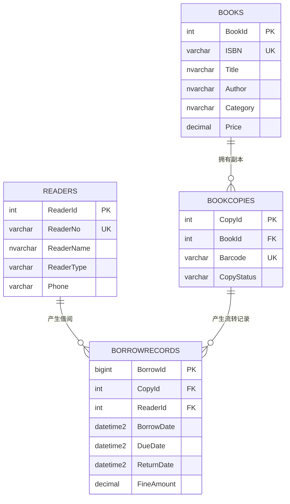

# SQL Server 图书借阅数据库实践

一个基于 SQL Server 与 T-SQL 实现的图书借阅数据管理项目。项目覆盖关系建模、约束设计、数据查询、借阅分析、视图封装、事务型存储过程和索引优化，适合作为数据库开发与实施岗位的代码作品。

## 项目概览

| 项目项 | 内容 |
| --- | --- |
| 数据库 | SQL Server 2019+ |
| 数据库名称 | `LibraryPractice` |
| 技术栈 | T-SQL、SQL Server、SSMS |
| 核心数据表 | 4 张 |
| 视图 | 2 个 |
| 存储过程 | 2 个 |
| 索引 | 1 个筛选唯一索引、2 个业务查询索引 |
| 示例数据 | 6 位读者、8 种图书、12 本实体副本、7 条借阅记录 |

## 业务能力

- 区分图书资料与实体库存，支持同一种图书存在多本实体副本。
- 记录读者、实体书条码、借阅日期、应还日期、归还日期和罚金。
- 通过状态字段与借阅历史共同描述图书当前状态和完整流转过程。
- 查询当前在借、逾期记录、读者借阅统计、分类排名和库存情况。
- 使用事务完成借书与还书，保证借阅记录和实体书状态同步更新。
- 使用筛选唯一索引阻止同一本实体书被重复借出。

## 数据库设计

### 实体关系



### 核心表

| 表名 | 职责 | 关键设计 |
| --- | --- | --- |
| `Readers` | 读者信息 | 业务编号 `ReaderNo` 唯一；读者类型通过 `CHECK` 限制 |
| `Books` | 图书资料 | ISBN 唯一；价格必须大于 0 |
| `BookCopies` | 实体库存 | 条码唯一；状态限定为可借、已借出或丢失 |
| `BorrowRecords` | 借阅流水 | 通过外键关联读者与实体书；到期日必须晚于借阅日；罚金不得为负数 |

### 数据完整性

- 使用主键保证每条记录具有稳定的内部标识。
- 使用外键保证借阅记录不会引用不存在的读者或实体书。
- 使用唯一约束保证读者编号、ISBN 和实体书条码不重复。
- 使用检查约束限制读者类型、副本状态、金额范围和日期范围。
- 使用筛选唯一索引保证同一实体书最多存在一条未归还记录。

## 关键实现

### 1. 借书与还书事务

`dbo.usp_BorrowBook` 和 `dbo.usp_ReturnBook` 均启用：

```sql
SET XACT_ABORT ON;
BEGIN TRY
    BEGIN TRANSACTION;
    -- 写入借阅记录并同步实体书状态
    COMMIT TRANSACTION;
END TRY
BEGIN CATCH
    IF @@TRANCOUNT > 0 ROLLBACK TRANSACTION;
    THROW;
END CATCH;
```

借书时会同时完成以下动作：

1. 校验读者与实体书是否存在。
2. 校验实体书是否可借。
3. 检查是否存在未归还的借阅记录。
4. 插入借阅记录。
5. 将实体书状态更新为 `BORROWED`。

还书时会计算逾期天数和罚金，写入归还时间，并将实体书恢复为 `AVAILABLE`。

并发校验使用 `UPDLOCK` 与 `HOLDLOCK`，避免两个并发操作同时将同一本实体书借给不同读者。

### 2. 借阅分析查询

项目包含以下查询能力：

- 多表连接查询读者、图书、实体书和借阅信息。
- 使用 `WHERE`、`GROUP BY`、`HAVING` 完成明细筛选与分类统计。
- 使用 `CASE WHEN` 识别当前在借和逾期状态。
- 使用 `DATEDIFF` 计算逾期天数，并按日费率计算预计罚金。
- 使用 `NOT EXISTS` 查询从未借书的读者。
- 使用 `RANK`、`ROW_NUMBER` 和窗口聚合完成分类排名和累计统计。

逾期记录的核心条件：

```sql
WHERE br.ReturnDate IS NULL
  AND br.DueDate < GETDATE()
```

### 3. 视图

| 视图 | 用途 |
| --- | --- |
| `dbo.vw_ActiveLoans` | 汇总当前在借记录，并计算逾期标记和逾期天数 |
| `dbo.vw_BookInventory` | 汇总每种图书的总副本数、可借数和借出数 |

### 4. 索引

| 索引 | 场景 |
| --- | --- |
| `UX_BorrowRecords_ActiveCopy` | 筛选唯一索引，阻止同一本实体书被重复借出 |
| `IX_BorrowRecords_Reader_Date` | 加速按读者查询借阅历史 |
| `IX_BookCopies_Book_Status` | 加速按图书和状态查询实体库存 |

索引脚本在执行前检查对象是否已存在，可以重复运行。

## 项目结构

```text
SQLServer-Portfolio/
├─ README.md
└─ sql/
   ├─ 00_check_environment.sql
   ├─ 01_create_database.sql
   ├─ 02_create_tables.sql
   ├─ 03_seed_data.sql
   ├─ 04_basic_queries.sql
   ├─ 05_advanced_queries.sql
   ├─ 06_views.sql
   ├─ 07_stored_procedures.sql
   ├─ 08_indexes.sql
   ├─ 09_call_procedures.sql
   ├─ 10_transaction_exercise.sql
   └─ 11_verify.sql
```

## 运行方式

### 环境要求

- SQL Server 2019 或更高版本
- SQL Server Management Studio 或其他兼容 T-SQL 的客户端

### 初始化数据库

在 SSMS 中依次执行：

```text
00_check_environment.sql
01_create_database.sql
02_create_tables.sql
03_seed_data.sql
```

> `02_create_tables.sql` 会删除并重建 `LibraryPractice` 中的 4 张练习表，重复执行会重置结构和数据。

### 创建数据库对象

依次执行：

```text
06_views.sql
07_stored_procedures.sql
08_indexes.sql
```

### 执行查询与功能验证

```text
04_basic_queries.sql
05_advanced_queries.sql
09_call_procedures.sql
10_transaction_exercise.sql
11_verify.sql
```

`09_call_procedures.sql` 会使用读者 `R005` 和实体书 `B011` 完成一次借书与还书。执行后，`B011` 应恢复为 `AVAILABLE`。

`10_transaction_exercise.sql` 演示事务内修改与 `ROLLBACK` 回滚，不会保留示例修改。

## 验收结果

`11_verify.sql` 用于核对数据库对象和业务状态。完整运行后的预期结果：

```text
表：4 张
视图：2 个
存储过程：2 个
读者：6 位
图书：8 种
实体副本：12 本
借阅记录：7 条
```

筛选唯一索引通过阻止重复在借记录保证数据一致性。

## 运行结果

### 数据库对象

展示 `LibraryPractice` 中的 4 张业务表和 2 个视图。


### 逾期借阅分析

使用多表连接、`DATEDIFF` 和条件过滤查询未归还的逾期记录，并计算预计罚金。


### 借书事务

调用 `dbo.usp_BorrowBook` 完成借书，结果返回借阅记录编号、读者编号、实体书条码和应还日期。


## 项目边界

该项目聚焦数据库层实现，不包含前端界面、Web API 和生产部署配置。示例读者、电话、图书及借阅数据均为虚构数据。
