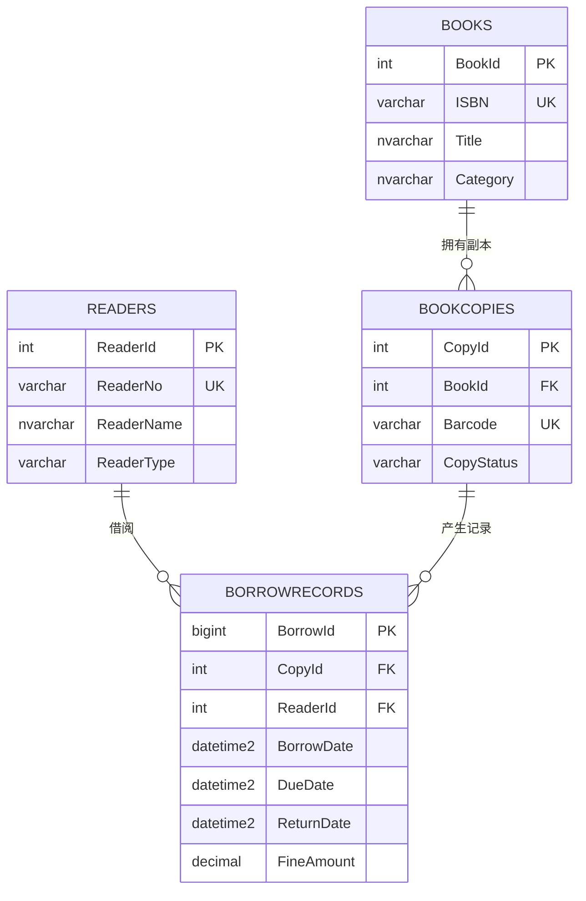

# SQL Server 图书借阅数据库实践

这是一个用于学习和求职展示的 SQL Server 小型项目。项目围绕图书借阅业务，包含数据建模、查询、视图、存储过程、事务和索引，不依赖任何第三方框架。

> 练习数据库名称：`LibraryPractice`
>
> 建议环境：SQL Server 2019 或更高版本、SQL Server Management Studio（SSMS）

## 1. 你将完成什么

项目包含 4 张核心业务表：

| 表名 | 作用 |
| --- | --- |
| `Readers` | 保存读者编号、姓名、类型和联系方式 |
| `Books` | 保存图书 ISBN、书名、作者、分类和定价 |
| `BookCopies` | 保存每一本实体书的条码和在馆状态 |
| `BorrowRecords` | 保存借书、还书、到期日、逾期天数和罚金 |



完成后你将掌握：

- 主键、外键、唯一约束和检查约束
- 多表连接、子查询、聚合、分组和窗口函数
- 视图封装常用查询
- 使用存储过程和事务完成借书、还书
- 为实际查询设计普通索引和筛选索引
- 使用 SSMS 验证结果并整理 GitHub 展示材料

## 2. 项目结构

```text
SQLServer-Portfolio/
├─ README.md
├─ 学习与讲解.md
└─ sql/
   ├─ 00_check_environment.sql
   ├─ 01_create_database.sql
   ├─ 02_create_tables.sql
   ├─ 03_seed_data.sql
   ├─ 04_basic_queries.sql
   ├─ 05_advanced_queries.sql
   ├─ 06_views.sql
   ├─ 07_stored_procedures.sql
   ├─ 08_indexes.sql
   ├─ 09_call_procedures.sql
   ├─ 10_transaction_exercise.sql
   └─ 11_verify.sql
```

## 3. 第一次运行

### 第 1 步：连接 SQL Server

1. 打开 SSMS。
2. 连接你平时使用的 SQL Server 实例。
3. 新建查询。

### 第 2 步：按顺序执行脚本

打开一个脚本后，点击“执行”或按 `F5`。必须严格按以下顺序运行：

1. `00_check_environment.sql`
2. `01_create_database.sql`
3. `02_create_tables.sql`
4. `03_seed_data.sql`

执行完成后，在左侧对象资源管理器中刷新 `LibraryPractice` 数据库，应该能看到 4 张表。

### 第 3 步：学习查询

1. 先运行 `04_basic_queries.sql`，观察每个结果集。
2. 再运行 `05_advanced_queries.sql`。
3. 对照 `学习与讲解.md`，理解每一步为什么这样写。

### 第 4 步：创建数据库对象

依次运行：

1. `06_views.sql`
2. `07_stored_procedures.sql`
3. `08_indexes.sql`

### 第 5 步：调用存储过程

运行 `09_call_procedures.sql`。脚本会：

1. 为读者 `R005` 办理条码 `B011` 的借书；
2. 查询当前借阅记录；
3. 办理还书；
4. 再次查询，确认该实体书恢复为可借状态。

### 第 6 步：体验事务

运行 `10_transaction_exercise.sql`。脚本故意执行 `ROLLBACK`，用于观察“修改后回滚”的效果。

### 第 7 步：最终验收

运行 `11_verify.sql`。重点确认：

- 数据表数量为 4；
- 16 条借阅记录不会重复借出同一本实体书；
- 当前借阅视图和逾期视图可以正常查询；
- 借书和还书能够更新实体书状态。

## 4. 推荐学习顺序

不要一次看完所有 SQL。按下面的顺序学习，每一步都先在纸上写出预期结果，再执行：

1. 能说出 4 张表分别保存什么数据。
2. 能画出 `Books -> BookCopies -> BorrowRecords <- Readers` 的关联。
3. 能独立写出图书、分类、借阅记录之间的 `JOIN`。
4. 能解释 `WHERE` 和 `HAVING` 的区别。
5. 能解释为什么借书、还书必须放在事务中。
6. 能说明筛选唯一索引如何防止一本实体书被重复借出。

## 5. 上传 GitHub

先在 SSMS 中完整跑通脚本，并理解结果。然后在本项目目录执行：

```powershell
git init
git add .
git commit -m "feat: add SQL Server library management portfolio"
git branch -M main
git remote add origin 你的仓库地址
git push -u origin main
```

不要上传数据库备份文件、账号密码、连接字符串或客户数据。

建议在 GitHub 仓库中补充 2 至 3 张截图：

1. 数据表关系或对象资源管理器截图；
2. 一个多表查询的结果；
3. 借书、还书存储过程执行成功的结果。

## 6. 跑通后可以写进简历的内容

确认自己实际运行并理解后，可以使用下面的项目描述：

> **SQL Server 图书借阅数据库实践｜个人项目**  
> 设计读者、图书、实体库存和借阅记录 4 张关联表，使用主外键、唯一约束和检查约束规范数据；编写多表连接、聚合统计、子查询和窗口函数完成借阅分析；通过视图封装在借和逾期查询，使用事务型存储过程处理借书、还书和逾期罚金，并设计普通索引与筛选唯一索引。项目脚本、说明文档与运行结果已发布至 GitHub。

只有完成 GitHub 上传后，最后一句才能写。

